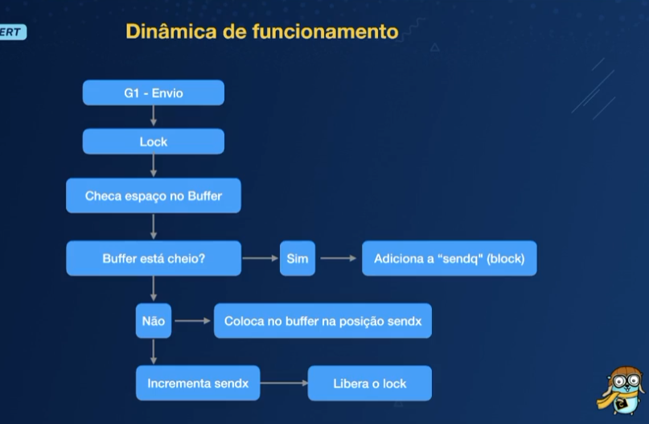
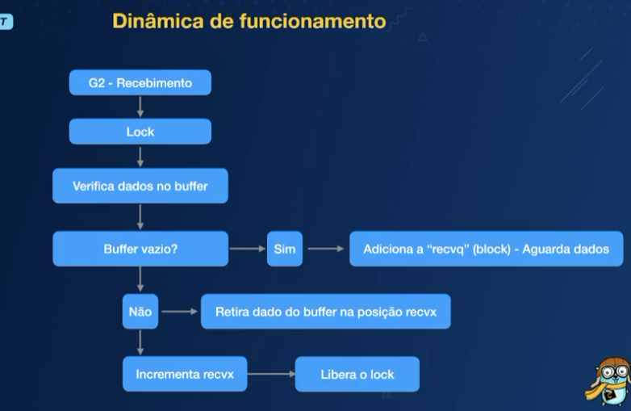
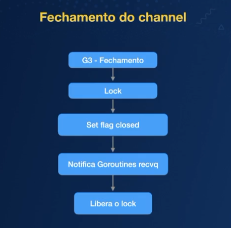
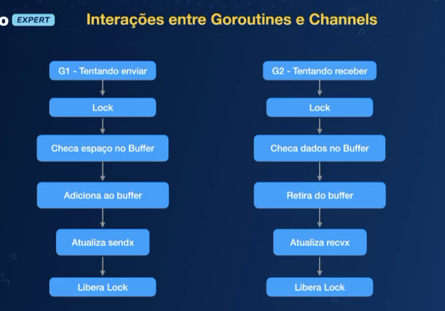
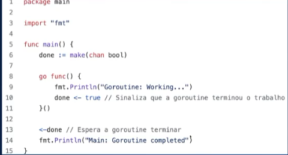
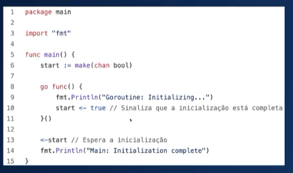
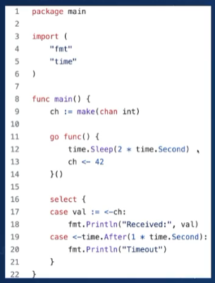
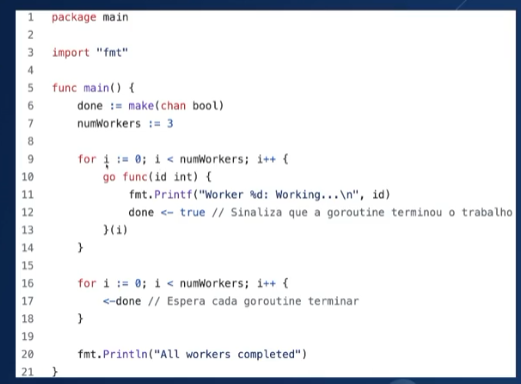

# Channels

Channels sao um mecanismo de comunicacao e sincronizacao entre goroutines no Go. Eles *permitem que goroutines troquem dados de maneira segura* e eficiente, suportando a construcao de programas concorrentes

## O problema de nao utilizar channels

### Problemas de sync

Quando a goroutine 1 (G1) quer passar um valor para a G2 ela altera um valor na memoria para a G2 ter acesso

O grande problema e que outras goroutines e partes do programa tambem podem ter acesso aquele endereco de memoria

Ou a g1 nao terminou completamente de alocar o valor em memoria e a g2 ja fez a leitura e eventualmente uma gravacao no mesmo local

### Dificuldade de trabalhar com concorrencia

Data race ou race condition
Pra remediar o problema utilizamos mutex (mutual exclusion)

Fazemos um lock do valor na memoria e durante esse momento, somente um goroutine pode fazer alteracao

Apos isso esse valor e liberado (unlock)

Mutex e similares abrem muita margem pra erro, pois tudo isso e feito de forma manual

## Tipos de channels

**Nao se comunique compartilhando memoria; em vez disso compartilhe memoria se comunicando**

Essa frase encapsula um dos principios fundamentais do design de sistemas concorrentes no Go. A ideia e que, ao usar channels para comunicacao entre goroutines, vce evita muito dos problemas associados a concorrencia e ao compartilamento de memoria direta, como condicoes de corrida e deadlocks

Em vez de varias goroutines acessarem diretamente variaveis compartilhadas (o que requer mecanismos de sincronizacao como locks), elas se comunicam enviando dados atraves de channels, o que proporciona uma maneira segura e clara de coordenar o acesso aos dados

Sao utilizados para passas informacoes entre goroutines de forma eficiente evitando a necessidade de locks explicitos e reduzindo complexidade de sincronizacao

- Nao bufferizados: requerem que a operacao de envio e recebimento ocorra simultaneamente, ideal pra sincronizacao direta entre goroutines

- Bufferizados: permitem que dados sejam armazenados temporariamente no buffer, permitindo que a goroutine de envio e a de recebimento sejam executadoas em tempos diferentes

## Estrutura interna de um channel

```go
type hchan struct {
    qcount   // queue count total de dados na fila
    dataqsz  // tamanha da fila circular (buffer)
    buf      // ponteiro para o array de elementos no buffer
    elemsize // tamanho de cada elemento
    closed   // flag indicando se o channel esta fchado
    sendx    // indice de envio
    recvx    // indice de recebimento
    recvq    // fila de gorountines esperando pra receber
    sendvq   // fila de gorountines esperando pra enviar
    lock     // mutex para sincronizacao
}
```






### Channels bufferizados

Quando devemos trabalhar com channels buferizados

- altas taxas de producao e consumo:
    Quando ha uma diferenca significativa nas taxas de producao e consumo de dados entre goroutines, chanels nao bufferizados podem causar gargalos

    Exemplo: se uma goroutine esta gerando dados muito mais rapido do que outra pode consumir, a goroutine produtora ficara frequentemente bloqueada esperando que a consumidora esteja pronta para receber, resultando em desempenho ineficiente

- pipeline de processamento
    Em pipelines de processamento de dados, onde os dados passam por varias etapas, cada uma implementada como uma goroutine, o uso de channels nao bufferizados pode causar bloqueios frequentes, dificultando o fluxo suave dos dados atraves do pipeline

    Exemplo: Se uma goroutine esta gerando dados muito mais rapido do que outra pode consumir, a goroutine produtora ficara frequentemente bloqueada esperando que a consumidora esteja prontoa pra receber, resultando em desempenho ineficiente

- tarefas assincronas
    Quando se trabalha com tarefas que nao precisam ser sincronizadas estritamente, como registros de logs ou coleta de metricas, usar channels nao bufferizados pode introduzir latencia desnecessaria

    Exemplo:
    Ao registrar logs em um servidor de alta carga, esperar que cada log seja processado anres de prosseguir pode impactar negativamente a performance. Um channel bufferizado permite que a producao de logs continue sem esperar pelo processamento de cada mensagem de log

- Comunicacao entre multiplas goroutines
    Quando ha comunicacao entre varias goroutines produtoras e consumidoras, channels nao bufferizados podem aumentar a contencao e reduzir a paralelizacao efetica

    Exemplo: Se varias goroutines tentam enviar dados para um unico channel nao bufferizado, elas competirao pelo acesso, resultado em bloqueios frequentes e menor desempenho

- Operacoes de I/O
    Em operacoes de I/O, onde o tempo de espera pode ser significativo, o uso de channels nao bufferizados pode levar a bloqueios desnecessarios

    Exemplo: Uma goroutine que le dados de um arquivo e outra que escreve esses dados em uma rede. Se a escrita na rede for mais lenta, a leitura do arquivo sera bloqueada frequentemente

Resumo dos problemas com channels nao bufferizados

- Bloqueios frequentres: podem resultar em bloqueios frequentes entre produtor e consumidos
- Gargalos de desempenho: Ineficiencia em casos de alta producao ou processamento lento
- Latencia: Introduz latencia desnecessaria em tarefas assincronas
- Contencao: Aumenta a contenca entre multiplas goroutines

### Channels nao bufferizados

- sincronizacoes estrita:
    Quando e necessario garantir que a producao e o consumo de dados ocorrem de maneira sincronizada, channels nao bufferizados sao ideais. Eles garantem que cada operacao de envio e emparelhada diretamente com uma operacao de recebimento

    

- handshake (aperto de mao)
    Em situacoes onde duas goroutines precisam trocar informacoes ou confirmar que uma acao foi realizada antes de prosseguir, channels nao bufferizados fornecem um mecanismo simples e seguro

    

- Eventos temporizados
    Quando voce precisa lidar com eventos temporizados, como timeouts, channels nao bufferizados podem ser usados em conjunto com o select para implementar timeouts de maneira simples e eficaz

    

- Coordenar finalizacao
    Quando varias goroutines precisam ser coordenadas para garantir que todas elas completem antes que o programa possa prosseguir, channels nao bufferizados podem ser utilizados para sinalizar a conclusao

    

### Parametrizacao do tamanho do buffer

- taxa de producao e consumo
    Taxa variavel: se a taxa de producao e consumo varia significativamente, um buffer maior pode ajudar a suavizar as diferencas e evitar bloqueios frequentes

    Taxa constante: se as taxas de producao e consumo sao constantes e iguais, um buffer menor pode ser suficiente

- Latencia e desempenho
    Baixa latencia: se a latencia e critica, um buffer menor pode ser preferivel para garantir que os dados sejam processados rapidamente

    Alto desempenho: um buffer maior pode ajudar a aumentar o desempenho em sistema de alta taxa de transferencia, reduzindo a contencao entre goroutines

- Memoria disponivel
    Uso de memoria: buffers grandes consomem mais memoria. Certifique-se de que ha memorias suficiente disponivel e consider o impacto no uso geral do sistema

- Padronizacao de pipelines
    Etapas de pipeline: se voce esta construindo um pipeline de processamento, cada etapa pode se beneficiar de um buffer que permite processar dados em lotes, melhorando a eficiencia geral

Resumo: **Nao ha um tamnho de buffer unico que seja ideal para todos os casos**. A escolha do tamanho deve ser baseada em:

- Taxa de producao e consumo
- Requisitos de latencia e desempenho
- Memoria disponivel
- Caracteristicas especificas do seu pipeline de processamento
- Monitorar e ajustar o tamanho do buffer conforme necessario, juntamente com testes de desempenho, pode ajudar a encontrar o equilibrio certo pra seu caso de uso especifico
